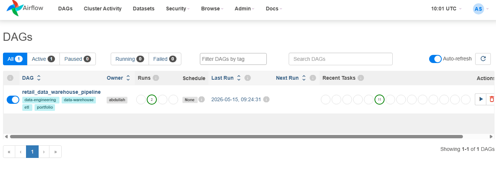
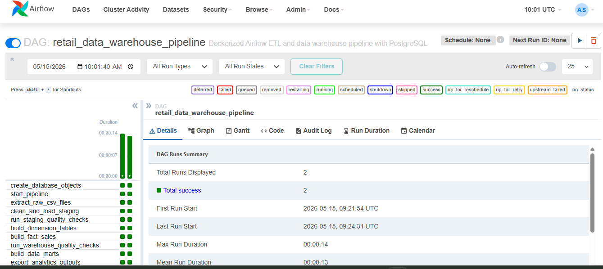
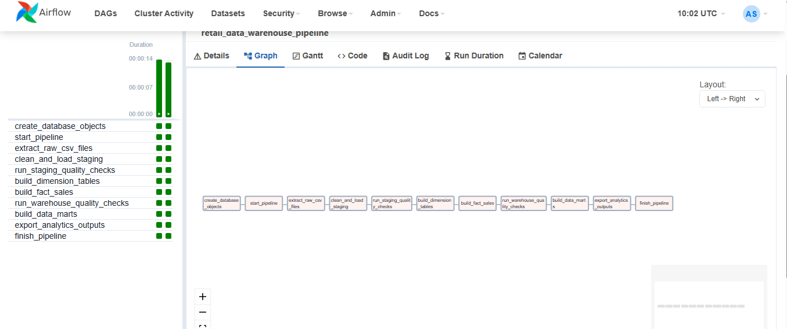
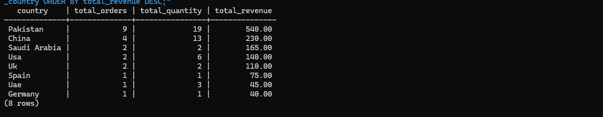
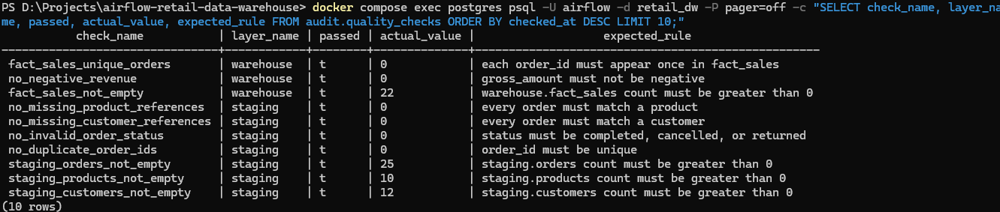
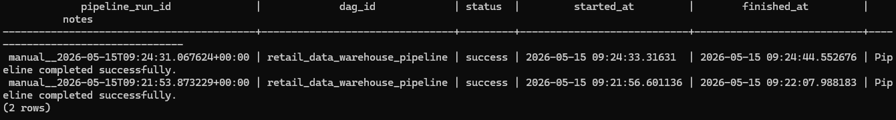
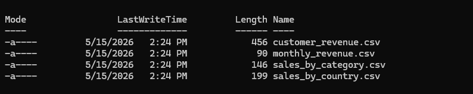

# Airflow Retail Data Warehouse Pipeline

## Project Summary

This is a data engineering portfolio project built with Apache Airflow, Docker Compose, PostgreSQL, Python, and SQL.

The project demonstrates a complete local batch data pipeline that extracts raw retail CSV files, loads them into PostgreSQL, cleans and standardizes the data, transforms it into a warehouse-style star schema, builds business-ready data marts, runs quality checks, tracks audit results, and exports analytics outputs.

This project was built to practice core data engineering and data warehousing concepts commonly discussed in entry-level interviews.

## Tech Stack

- Apache Airflow
- Docker Compose
- PostgreSQL
- Python
- SQL
- Git and GitHub

## Key Concepts Demonstrated

- ETL
- ELT-style SQL transformation
- Data warehousing
- Raw, staging, warehouse, mart, and audit layers
- Star schema design
- Fact and dimension tables
- Data marts
- Data quality checks
- Pipeline audit logging
- Batch processing
- Workflow orchestration
- Airflow DAG task dependencies
- PostgreSQL analytics queries
- CSV export outputs

## Architecture

Raw CSV Files  
-> Apache Airflow DAG  
-> Raw PostgreSQL Tables  
-> Staging Tables  
-> Warehouse Star Schema  
-> Business Data Marts  
-> Analytics CSV Exports  

## Airflow Pipeline Flow

1. create_database_objects
2. start_pipeline
3. extract_raw_csv_files
4. clean_and_load_staging
5. run_staging_quality_checks
6. build_dimension_tables
7. build_fact_sales
8. run_warehouse_quality_checks
9. build_data_marts
10. export_analytics_outputs
11. finish_pipeline

## Database Layers

### 1. Raw Layer

The raw layer stores source data as received from CSV files.

Tables:

- raw.customers_raw
- raw.products_raw
- raw.orders_raw
- raw.payments_raw

### 2. Staging Layer

The staging layer stores cleaned, standardized, and typed data.

Tables:

- staging.customers
- staging.products
- staging.orders
- staging.payments

Example transformations:

- Trimming text fields
- Standardizing country, product, and category names
- Converting dates from text to DATE
- Converting prices and amounts to numeric values
- Lowercasing order and payment status fields
- Filtering invalid quantities and invalid prices

### 3. Warehouse Layer

The warehouse layer stores analytics-ready data in a star schema.

Dimension tables:

- warehouse.dim_customers
- warehouse.dim_products
- warehouse.dim_date

Fact table:

- warehouse.fact_sales

The fact table links customer, product, and date dimensions with sales measures such as quantity, unit price, gross amount, payment amount, order status, and payment status.

### 4. Mart Layer

The mart layer stores business-ready aggregated tables.

Tables:

- mart.sales_by_country
- mart.sales_by_category
- mart.monthly_revenue
- mart.customer_revenue

These marts are designed for direct reporting and business analysis.

### 5. Audit Layer

The audit layer tracks pipeline execution and validation results.

Tables:

- audit.pipeline_runs
- audit.quality_checks

The pipeline logs run status, start time, finish time, and quality check results.

## Data Quality Checks

The project includes validation checks at the staging and warehouse layers.

Examples:

- Staging customers table must not be empty
- Staging products table must not be empty
- Staging orders table must not be empty
- Order IDs must be unique
- Order status must be valid
- Every order must match a customer
- Every order must match a product
- Fact sales table must not be empty
- Revenue must not be negative
- Each order must appear only once in the fact table

If a check fails, the Airflow task fails and the issue is visible in task logs.

## Screenshots

### Airflow DAG List

### Airflow Grid Success

### Airflow Graph View

### PostgreSQL Sales by Country Result

### Data Quality Checks

### Pipeline Audit Success

### Exported CSV Output Files

## Example SQL Results

### Sales by Country

Query:

SELECT * FROM mart.sales_by_country ORDER BY total_revenue DESC;

Example result:

| country | total_orders | total_quantity | total_revenue |
|---|---:|---:|---:|
| Pakistan | 9 | 19 | 540.00 |
| China | 4 | 13 | 230.00 |
| Saudi Arabia | 2 | 2 | 165.00 |
| USA | 2 | 6 | 140.00 |
| UK | 2 | 2 | 110.00 |

### Sales by Category

Query:

SELECT * FROM mart.sales_by_category ORDER BY total_revenue DESC;

Example result:

| category | total_orders | total_quantity | total_revenue |
|---|---:|---:|---:|
| Electronics | 9 | 17 | 560.00 |
| Home Office | 6 | 6 | 470.00 |
| Lifestyle | 5 | 9 | 255.00 |
| Stationery | 2 | 15 | 60.00 |

## How to Run Locally

Start Docker Desktop first.

Clone the repository:

git clone https://github.com/YOUR_USERNAME/airflow-retail-data-warehouse.git

cd airflow-retail-data-warehouse

Initialize Airflow:

docker compose up airflow-init

Start the containers:

docker compose up -d

Check running containers:

docker compose ps

Open Airflow in the browser:

http://localhost:8080

Login:

username: admin  
password: admin

Trigger the DAG:

retail_data_warehouse_pipeline

## Verify Results

Run this query:

docker compose exec postgres psql -U airflow -d retail_dw -P pager=off -c "SELECT * FROM mart.sales_by_country ORDER BY total_revenue DESC;"

Run this query:

docker compose exec postgres psql -U airflow -d retail_dw -P pager=off -c "SELECT * FROM mart.sales_by_category ORDER BY total_revenue DESC;"

Run this query:

docker compose exec postgres psql -U airflow -d retail_dw -P pager=off -c "SELECT check_name, layer_name, passed, actual_value, expected_rule FROM audit.quality_checks ORDER BY checked_at DESC LIMIT 10;"

Check exported CSV files:

Get-ChildItem data\output

## Project Structure

airflow-retail-data-warehouse/
- dags/
  - retail_dw_pipeline.py
- data/
  - raw/
    - customers.csv
    - products.csv
    - orders.csv
    - payments.csv
  - output/
    - sales_by_country.csv
    - sales_by_category.csv
    - monthly_revenue.csv
    - customer_revenue.csv
- postgres/
  - init/
    - 01_create_retail_dw.sql
- screenshots/
  - 01_airflow_dag_list.png
  - 02_airflow_grid_success.png
  - 03_airflow_graph_view.png
  - 04_sales_by_country_sql.png
  - 05_data_quality_checks.png
  - 06_pipeline_audit_success.png
  - 07_output_csv_files.png
- sql/
  - analysis_queries.sql
- docker-compose.yaml
- .env
- .gitignore
- README.md

## Interview Explanation

I built a Dockerized Airflow data warehouse pipeline to practice data engineering fundamentals. The pipeline extracts raw CSV files, loads them into PostgreSQL raw tables, cleans and standardizes the data into staging tables, transforms it into a star schema with customer, product, and date dimensions, builds a fact sales table, and creates business-ready data marts.

I also added data quality checks and audit tables to track pipeline runs and validation results. Airflow orchestrates the full workflow through DAG task dependencies, retries, and logs. This helped me understand ETL, ELT-style transformations, data warehousing layers, fact and dimension modeling, data marts, and workflow orchestration.

## CV Bullet

Built a Dockerized Apache Airflow data warehouse pipeline using PostgreSQL, Python, and SQL to ingest raw retail CSV data, clean and validate it into staging tables, transform it into a star schema with dimension and fact tables, build business-ready data marts, and track pipeline quality through audit logs and Airflow task monitoring.

## Future Improvements

- Add dbt for SQL model management
- Add Great Expectations for richer data validation
- Add Power BI dashboard using the mart tables
- Add API-based data extraction
- Add incremental loading instead of full refresh
- Add CI checks for Python and SQL files
